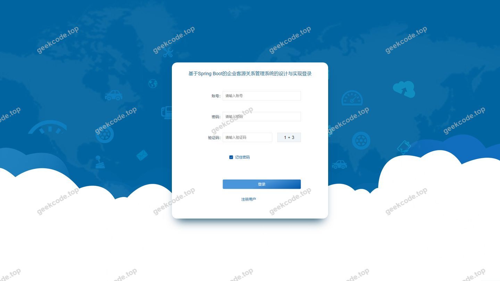
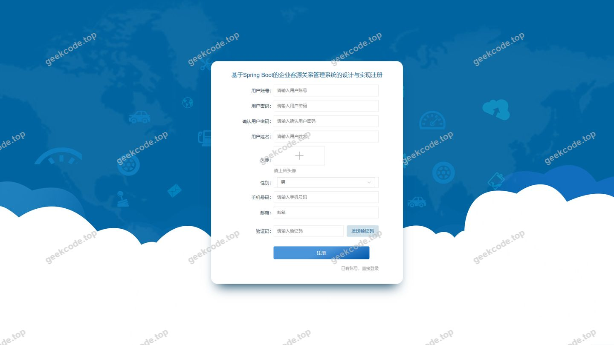
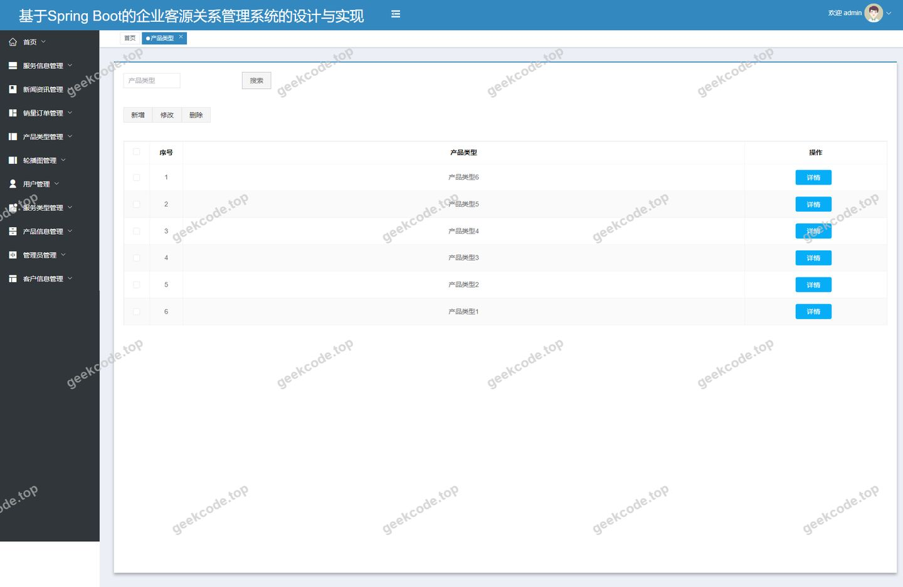
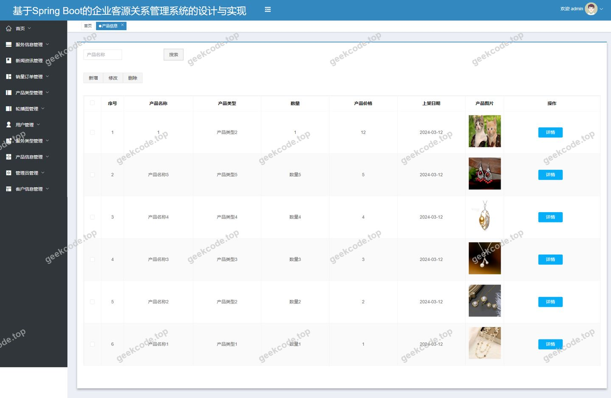
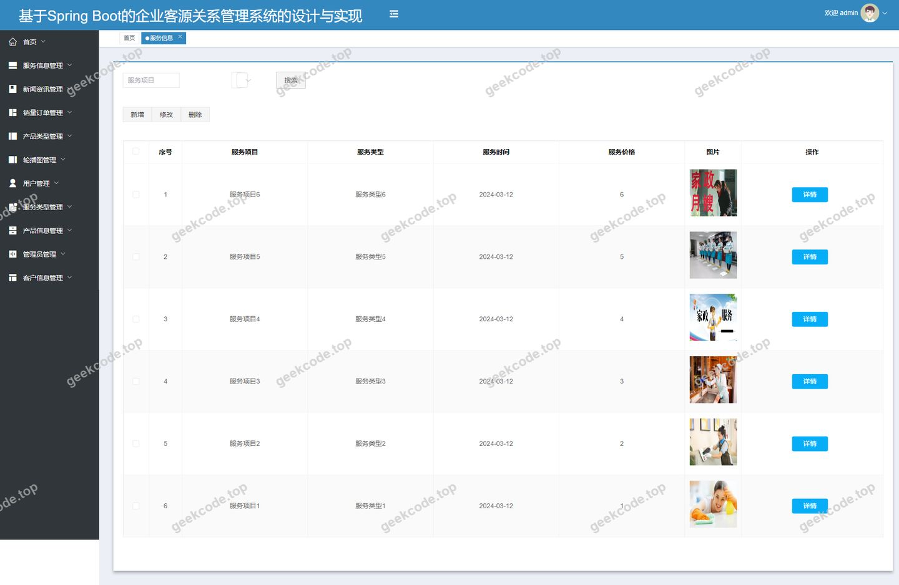
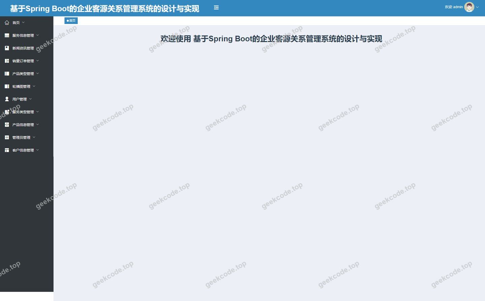
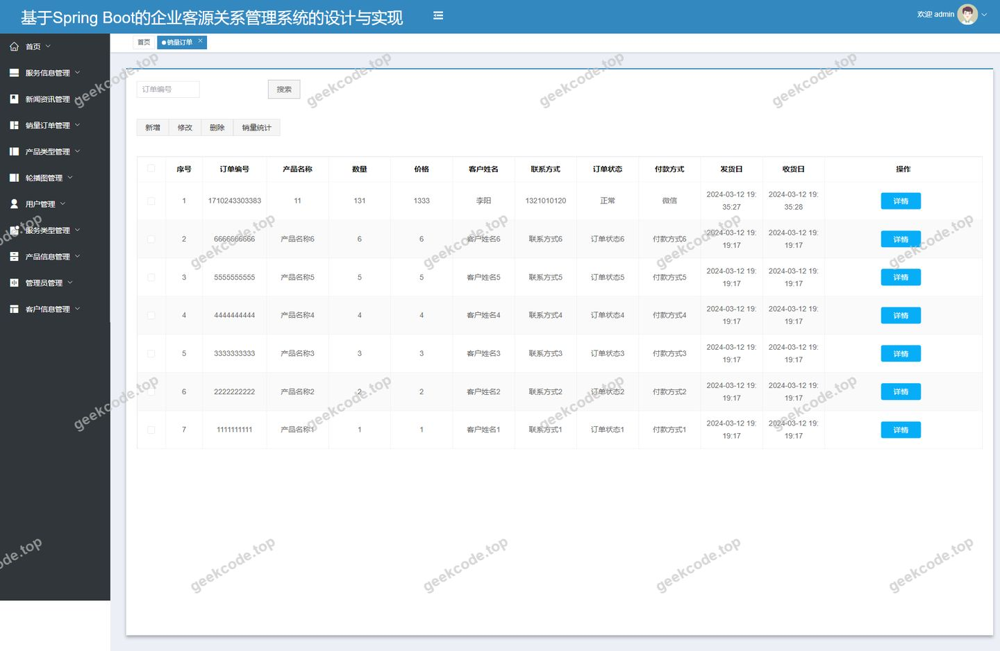
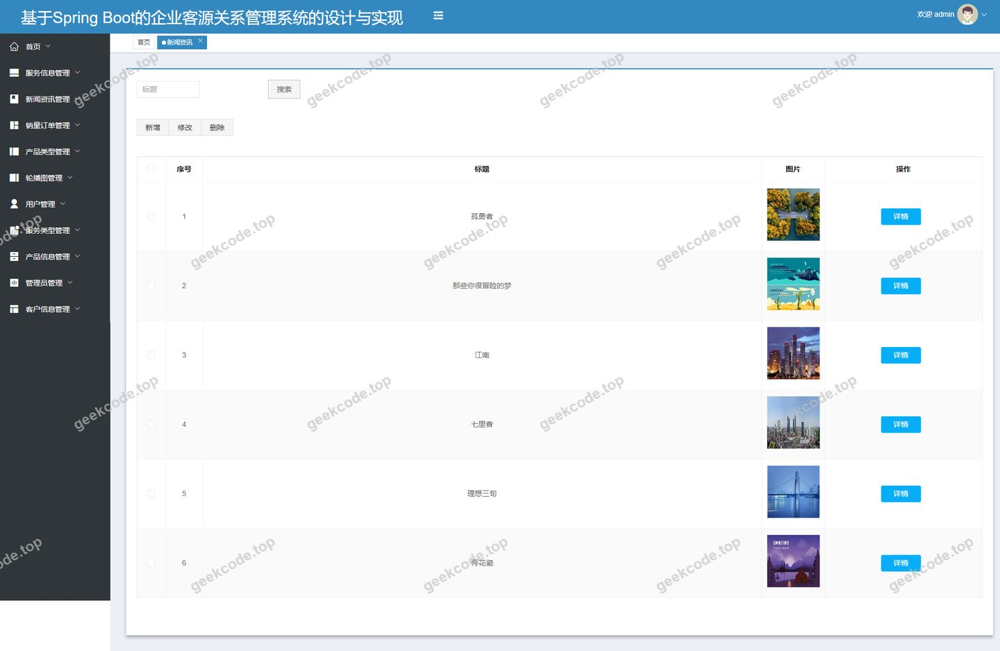
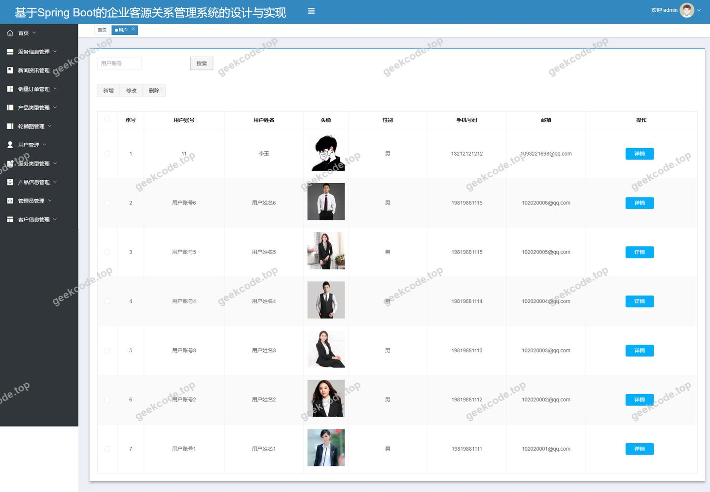

# 基于Spring Boot的企业客源关系管理系统的设计与实现

> 🎓 **计算机毕业设计 · 基于Spring Boot的企业客源关系管理系统的设计与实现**
>
> 本仓库只放**项目介绍 + 运行截图**（截图是站点带水印的原图，存在仓库 `images/` 里）。
>
> 👉 **完整可运行源码 / 数据库脚本 / 部署文档：[点我获取](https://geekcode.top/archives/%E5%9F%BA%E4%BA%8ESpring-Boot%E7%9A%84%E4%BC%81%E4%B8%9A%E5%AE%A2%E6%BA%90%E5%85%B3%E7%B3%BB%E7%AE%A1%E7%90%86%E7%B3%BB%E7%BB%9F%E7%9A%84%E8%AE%BE%E8%AE%A1%E4%B8%8E%E5%AE%9E%E7%8E%B0?utm_source=github)**
>
> 💬 咨询微信：**ir9372**　|　🌐 更多项目：[极客代码 geekcode.top](https://geekcode.top/?utm_source=github)
>
> 📌 项目详情页：<https://geekcode.top/archives/%E5%9F%BA%E4%BA%8ESpring-Boot%E7%9A%84%E4%BC%81%E4%B8%9A%E5%AE%A2%E6%BA%90%E5%85%B3%E7%B3%BB%E7%AE%A1%E7%90%86%E7%B3%BB%E7%BB%9F%E7%9A%84%E8%AE%BE%E8%AE%A1%E4%B8%8E%E5%AE%9E%E7%8E%B0?utm_source=github>

<table><td width="230" align="center"> <b>扫码加微信 ir9372</b></td><td valign="middle">📦 源码 = 项目介绍 + 全部运行截图 + 数据库 + 部署文档 👉 点上方任意截图，直接跳到 <b>极客代码 geekcode.top</b> 详情页</td></table>

---

<h1>基于Spring Boot的企业客源关系管理系统的设计与实现</h1>
<h2>项目概述</h2>

本项目名为“基于Spring Boot的企业客源关系管理系统的设计与实现”，旨在为企业构建一套高效、规范的客户关系管理（CRM）平台。系统采用前后端分离架构，核心功能涵盖用户注册登录、客户信息管理、产品与服务分类维护、销量订单处理及新闻资讯发布等模块。通过数字化的手段，帮助企业实现从潜在客户获取到销售转化全流程的数据化管理，提升客户响应速度与服务质量。

适用人群主要包括企业管理人员、销售人员以及普通注册用户。技术架构上，后端基于 Spring Boot 框架，集成 MyBatis-Plus 进行数据持久层操作，并使用 Apache Shiro 保障系统安全；前端采用 Vue 技术栈，实现了丰富的交互界面。该系统能够有效解决传统人工管理中信息分散、统计滞后等问题，助力企业精准营销与精细化运营。

<h2>技术架构</h2>
<h3>1. 总体架构设计</h3>

本项目采用经典的前后端分离架构模式。

<ul>
<li><strong>后端服务</strong>：基于 Java 语言开发，使用 Spring Boot 作为核心框架，提供 RESTful API 接口。利用 MyBatis-Plus 简化数据库 CRUD 操作，Apache Shiro 负责身份认证与授权控制。</li>
<li><strong>前端应用</strong>：基于 Vue.js 框架构建单页面应用（SPA），通过 Axios 与后端接口进行异步通信，实现数据的动态渲染与交互。</li>
<li><strong>数据库</strong>：使用 MySQL 存储业务数据，包括用户信息、产品详情、订单记录等。</li>
</ul>
<h3>2. 核心技术选型理由</h3>
<ul>
<li><strong>Spring Boot</strong>: 提供了自动配置和起步依赖，极大地简化了搭建过程，适合快速开发微服务或单体应用，具备良好的扩展性。</li>
<li><strong>MyBatis-Plus</strong>: 在 MyBatis 的基础上增强了通用 CRUD 方法，减少了大量样板代码的编写，提高了开发效率，同时支持复杂的 SQL 定制。</li>
<li><strong>Apache Shiro</strong>: 相比 Spring Security，Shiro 更加轻量级且易于理解，能够灵活地处理认证、授权、加密和会话管理，非常适合中小型项目的权限控制需求。</li>
<li><strong>Vue.js</strong>: 组件化开发模式使得前端代码复用率高，双向数据绑定机制提升了用户体验，配合 Element UI 等组件库可快速构建美观的管理后台。</li>
</ul>
<h3>3. 数据库设计要点</h3>

根据路由和功能模块推断，数据库主要包含以下实体表结构：

<ul>
<li><strong>用户表 (yonghu)</strong>: 存储前台注册用户的基本信息。</li>
<li><strong>管理员表 (users)</strong>: 存储后台管理人员账号信息。</li>
<li><strong>客户信息表 (kehuxinxi)</strong>: 记录企业的潜在或现有客户资料。</li>
<li><strong>产品信息表 (chanpinxinxi)</strong>: 存储企业提供的具体产品详情。</li>
<li><strong>产品类型表 (chanpinleixing)</strong>: 用于对产品分类进行管理。</li>
<li><strong>服务信息表 (fuwuxinxi)</strong>: 记录企业提供的服务内容。</li>
<li><strong>服务类型表 (fuwuleixing)</strong>: 用于对服务进行分类。</li>
<li><strong>销量订单表 (xiaoliangdingdan)</strong>: 跟踪产品的销售情况和订单状态。</li>
<li><strong>收藏表 (storeup)</strong>: 记录用户对内容或产品的收藏行为。</li>
<li><strong>新闻表 (news)</strong>: 发布企业新闻或行业资讯。</li>
<li><strong>配置表 (config)</strong>: 存储系统全局配置参数。</li>
<li><strong>邮件验证码表 (emailregistercode)</strong>: 辅助用户注册时的邮箱验证流程。</li>
</ul>
<h2>功能模块</h2>
<h3>1. 前台用户端功能</h3>

前台面向普通注册用户，提供信息浏览与管理功能。

<ul>
<li><strong>首页与资讯浏览</strong></li>
<li><strong>首页展示</strong>: 聚合显示最新的产品、服务及新闻信息。</li>
<li><strong>新闻资讯列表/详情</strong>: 查看企业发布的各类新闻文章。</li>
<li><strong>用户中心</strong></li>
<li><strong>注册与登录</strong>: 支持用户注册（含邮箱验证码验证）、登录及个人中心访问。</li>
<li><strong>个人信息管理</strong>: 修改个人资料，查看账户状态。</li>
<li><strong>业务信息管理</strong></li>
<li><strong>客户信息管理</strong>: 用户可以添加、编辑、删除并查询自己的客户信息列表及详情。</li>
<li><strong>产品信息管理</strong>: 浏览产品列表，查看产品详情，并可对产品信息进行增删改查操作。</li>
<li><strong>服务信息管理</strong>: 管理服务相关条目，包括新增、修改、删除及查看详情。</li>
<li><strong>分类管理</strong>: 查看和管理“产品类型”与“服务类型”的分类信息。</li>
<li><strong>交易与互动</strong></li>
<li><strong>销量订单管理</strong>: 创建新的销量订单，查看订单列表及详细状态，支持订单信息的修改与删除。</li>
<li><strong>我的收藏</strong>: 查看已收藏的内容列表。</li>
</ul>
<h3>2. 后台管理端功能</h3>

后台面向系统管理员，提供全面的数据管理与系统配置功能。

<ul>
<li><strong>系统概览</strong></li>
<li><strong>后台首页</strong>: 展示关键数据统计图表或快捷入口。</li>
<li><strong>登录页</strong>: 管理员身份验证入口。</li>
<li><strong>基础数据管理</strong></li>
<li><strong>用户管理 (/yonghu)</strong>: 对前台注册用户进行查询、编辑、删除等操作。</li>
<li><strong>管理员管理 (/users)</strong>: 维护后台管理员账号信息。</li>
<li><strong>系统配置 (/config)</strong>: 设置系统运行所需的全局参数。</li>
<li><strong>业务数据管理</strong></li>
<li><strong>客户信息管理 (/kehuxinxi)</strong>: 审核、管理所有用户的客户数据。</li>
<li><strong>产品信息管理 (/chanpinxinxi)</strong>: 维护产品库，确保数据准确性。</li>
<li><strong>产品类型管理 (/chanpinleixing)</strong>: 定义和维护产品分类体系。</li>
<li><strong>服务信息管理 (/fuwuxinxi)</strong>: 更新服务描述及相关数据。</li>
<li><strong>服务类型管理 (/fuwuleixing)</strong>: 维护服务分类标签。</li>
<li><strong>销量订单管理 (/xiaoliangdingdan)</strong>: 监控全平台的订单流转情况，处理异常订单。</li>
<li><strong>新闻资讯管理 (/news)</strong>: 发布、编辑或删除前台展示的新闻内容。</li>
<li><strong>收藏记录管理 (/storeup)</strong>: 查看用户的收藏行为数据（如有此权限）。</li>
</ul>
<h2>用户角色与权限</h2>

本系统主要涉及两种角色：<strong>前台用户</strong>和<strong>后台管理员</strong>。

<table>
<thead>
<tr>
<th align="left">角色</th>
<th align="left">权限描述</th>
<th align="left">可访问的功能模块</th>
</tr>
</thead>
<tbody><tr>
<td align="left"><strong>前台用户</strong></td>
<td align="left">拥有个人数据的读写权限，可浏览公共信息并进行相关业务操作。</td>
<td align="left">1. <strong>个人中心</strong>: 注册、登录、修改个人信息。2. <strong>资讯浏览</strong>: 查看新闻列表及详情。3. <strong>业务操作</strong>: - 管理自己的客户信息（增删改查）。- 浏览及管理产品信息（视具体逻辑而定，通常侧重浏览或录入自有产品）。- 管理服务信息及类型。- 创建和管理自己的销量订单。- 查看我的收藏。</td>
</tr>
<tr>
<td align="left"><strong>后台管理员</strong></td>
<td align="left">拥有系统最高权限，可对全量数据进行管理、配置及审核。</td>
<td align="left">1. <strong>系统管理</strong>: 登录、系统配置、管理员账号维护。2. <strong>用户管理</strong>: 查看所有前台用户信息，执行禁用或删除操作。3. <strong>数据管理</strong>: - 全量管理客户信息、产品信息、服务信息及其对应类型。- 监控和处理所有销量订单。- 发布和管理新闻资讯。- 查看收藏记录等日志类数据。</td>
</tr>
</tbody></table>
<h2>项目特色与创新点</h2>
<ol>
<li>
<strong>完整的 CRM 闭环管理</strong>：
   系统不仅局限于简单的信息录入，而是涵盖了从“客户线索（客户信息）”到“产品/服务供给（产品/服务信息）”再到“交易转化（销量订单）”的完整业务链条。这种设计贴合企业实际运营场景，有助于管理者清晰掌握业务流向。

</li>
<li>
<strong>细粒度的分类管理体系</strong>：
   针对“产品”和“服务”分别设计了独立的“类型”管理模块（<code>chanpinleixing</code>, <code>fuwuleixing</code>），允许管理员灵活定义分类标准。这种结构化的数据组织方式，便于后续进行多维度的数据分析与检索优化。

</li>
<li>
<strong>前后端分离的安全架构</strong>：
   引入 Apache Shiro 进行统一的安全管控，结合 JWT 或 Session 机制（视具体实现而定，但 Shiro 本身提供强大的会话管理），确保了接口调用的安全性。同时，邮箱验证码注册机制（<code>emailregistercode</code>）增加了用户身份的真实性校验，提升了系统的可信度。

</li>
<li>
<strong>高效的开发与维护体验</strong>：
   后端使用 MyBatis-Plus 大幅减少了 SQL 映射文件的编写工作量，前端使用 Vue 组件化开发使得界面模块独立、易于复用。这种技术组合在保证系统稳定性的同时，显著降低了后期迭代维护的成本。

</li>
</ol>
<h2>部署环境</h2>

为确保系统正常运行，需准备以下软件环境：

<ul>
<li><strong>操作系统</strong>: Windows 7/10/11, Linux (CentOS/Ubuntu), 或 macOS。</li>
<li><strong>Java 环境</strong>: JDK 1.8 或更高版本（建议 JDK 1.8，以兼容大多数 Spring Boot 版本）。</li>
<li><strong>数据库</strong>: MySQL 5.7 或 MySQL 8.0。</li>
<li><strong>构建工具</strong>: Maven 3.6+ （用于后端依赖管理及打包）。</li>
<li><strong>前端环境</strong>: Node.js 12.x - 16.x，npm 或 yarn （用于前端项目依赖安装及编译）。</li>
<li><strong>Web 服务器</strong>: Nginx 或 Tomcat （用于托管前端静态资源及反向代理后端接口）。</li>
<li><strong>其他</strong>: Git （版本控制），IDEA/Eclipse （后端开发），VS Code/WebStorm （前端开发）。</li>
</ul>
<h2>五、技术特性</h2>
<ul>
<li>前后端分离架构，前端独立部署</li>
<li>使用 MyBatis-Plus 简化数据访问层开发</li>
<li>集成 Shiro 权限框架实现角色权限控制</li>
</ul>
<h2>六、功能模块截图</h2>
<h3>前台用户端</h3>
<h4>前台-首页</h4>

<h4>前台-登录</h4>

<h4>前台-用户注册</h4>

<h3>后台管理端</h3>
<h4>后台-产品类型</h4>

<h4>后台-产品信息</h4>

<h4>后台-登录页</h4>

<h4>后台-服务信息</h4>

<h4>后台首页</h4>

<h4>后台-销量订单</h4>

<h4>后台-新闻资讯</h4>

<h4>后台-用户</h4>

---

## 获取完整源码

| 项目 | 说明 |
| --- | --- |
| 项目名 | 基于Spring Boot的企业客源关系管理系统的设计与实现 |
| 运行截图 | 本文 11 张（站点带水印原图，仓库 `images/` 目录） |
| 完整源码 | [https://geekcode.top/archives/%E5%9F%BA%E4%BA%8ESpring-Boot%E7%9A%84%E4%BC%81%E4%B8%9A%E5%AE%A2%E6%BA%90%E5%85%B3%E7%B3%BB%E7%AE%A1%E7%90%86%E7%B3%BB%E7%BB%9F%E7%9A%84%E8%AE%BE%E8%AE%A1%E4%B8%8E%E5%AE%9E%E7%8E%B0?utm_source=github](https://geekcode.top/archives/%E5%9F%BA%E4%BA%8ESpring-Boot%E7%9A%84%E4%BC%81%E4%B8%9A%E5%AE%A2%E6%BA%90%E5%85%B3%E7%B3%BB%E7%AE%A1%E7%90%86%E7%B3%BB%E7%BB%9F%E7%9A%84%E8%AE%BE%E8%AE%A1%E4%B8%8E%E5%AE%9E%E7%8E%B0?utm_source=github) |
| 咨询微信 | **ir9372**（备注：jingpin-yuanma） |
| 更多项目 | [极客代码 geekcode.top](https://geekcode.top/?utm_source=github) |

> 需要源码、部署、改配置、跑不起来等问题，加微信 ir9372 沟通，说明项目名即可。
